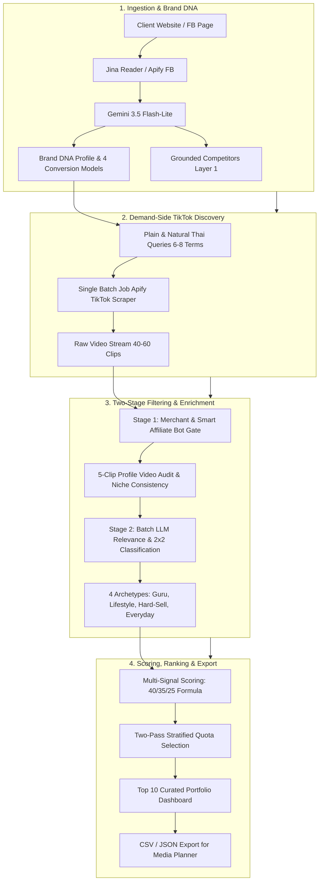

# Convert Cake — Thai TikTok KOL/KOC Discovery & Matching Engine

[](./backend/tests)
[](./backend)
[](https://fastapi.tiangolo.com)
[-61dafb?style=flat-square&logo=react)](./frontend)
[](https://langchain-ai.github.io/langgraph/)
[](https://aistudio.google.com)
[](./docker-compose.yml)

> **Production-Grade Influencer Discovery & Matching Engine for Performance-Only Marketing Agencies**  
> ยุติการค้นหาแบบสุ่ม (Manual Guesswork) และกำจัดขยะบอทสแปมตะกร้า โดยเปลี่ยนผ่านสู่ **100% Pure Live Discovery Engine** พร้อมระบบจำแนก 4 Business Conversion Models, 2x2 KOL/KOC Matrix, และการตรวจสอบคู่แข่งแบบ Grounded 3 ชั้น

---

## 📌 Executive Summary & Key Highlights

1. **Dual-Mode Execution (Dry Run & 100% Live API Mode):**
   - **⚡ โหมด Dry Run (Pre-recorded Real Dataset):** จำลองการทำงานจากผลลัพธ์การรันจริงของ 6 แบรนด์ตัวอย่างโดยไม่ต้องใช้ API Key เพื่อความสะดวกในการตรวจประเมินทันที
   - **🚀 โหมด Live API (100% Real-Time Pipeline):** สกัดข้อมูลสดจาก Website ลูกค้า (Jina Reader API), Facebook Page (Apify Facebook Scraper) และค้นหาครีเอเตอร์จริงบน TikTok Thailand (Apify Actor) แบบ Real-Time
2. **4 Brand Conversion Models & Media Mix Recommendation:**
   - วิเคราะห์โมเดลการทำเงินของแบรนด์ลูกค้า (`ECOMMERCE_PRODUCT`, `APP_DIGITAL_SERVICE`, `HIGH_TICKET_LEADGEN`, `LIFESTYLE_EXPERIENCE`) เพื่อแนะนำสัดส่วนผสมผสานระหว่าง **KOL (สร้าง Awareness & Trust)** และ **KOC (ปิดการขาย & ป้ายยา)** อย่างตรงจุด
3. **Demand-Side vs. Supply-Side Natural Thai Search Extraction:**
   - แก้ปัญหา Search Overfitting โดยสกัดเฉพาะคำค้นหาธรรมชาติสั้นกระชับ (2–4 คำ $\le 18$ ตัวอักษร) ที่ผู้บริโภคจริงใช้ค้นหาคลิปบน TikTok ป้องกันไม่ให้คำค้นหาฝั่งผู้ผลิต (โรงงาน, รับผลิต, ขายส่ง) หลุดเข้าไปยึดพื้นที่ค้นหา
4. **Two-Stage Entity & Smart Affiliate Bot Trap Gate:**
   - **Gate 1 (Rule-Based):** กรองร้านค้า Official, ร้านค้าคู่แข่ง, โรงงานรับผลิต และดักจับบอทสแปมตะกร้าด้วย **Multi-Condition AND Gate** (ตะกร้าเหลือง >85% + ไม่รับงาน + ยอดปฏิสัมพันธ์ต่ำ) โดย **ไม่ตัดสิทธิ์ KOC สายป้ายยาตัวท็อป**
   - **Gate 2 (Batch LLM):** ตรวจสอบ Content Relevance และจำแนกบทบาท 2x2 Matrix ใน 1 API Call
5. **2x2 Creator Matrix & 4 Core Sub-styles:**
   - 🧠 **KOL (Top/Mid Funnel):** `KOL - Expert / Guru` (เน้น Save/Utility), `KOL - Lifestyle / Aesthetic` (เน้น Mood & Tone / Views)
   - 🛍️ **KOC (Bottom Funnel):** `KOC - Hard-Sell Reviewer` (เน้นตะกร้า & Conversion), `KOC - Everyday User / Vlog` (เน้นความเรียล & High ER)
6. **100-Point Dynamic Performance Scoring (40 / 35 / 25):**
   - **40% Brand & Funnel Relevance:** Semantic Cosine Similarity (`gemini-embedding-2`) + LLM Niche & Work-Ready Bonus
   - **35% Engagement Quality & View Consistency:** Median ER (เฉพาะคลิป $\ge 500$ วิว ป้องกันคลิปฟลุ๊ค) + Save/Share Utility + View Consistency
   - **25% Audience Proxy & Commercial Viability:** Thai Authenticity Ratio + Buyer Intent Proxy (Comment/Like) + Brand-Adaptive Commercial Health
7. **Two-Pass Stratified Quota Portfolio (Top 10 Curated):**
   - การันตีสัดส่วนครีเอเตอร์ครบทุกมิติ Funnel ใน Pass ที่ 1 ก่อนเติมเต็มโควตาด้วยคะแนน Performance ใน Pass ที่ 2
8. **Multi-Tier SQLite Scraper Cache:**
   - แคชผลลัพธ์ Network I/O แบบแยก TTL (Web 3 วัน, FB 2 วัน, TikTok Search 12 ชม., Profile Clips 24 ชม.) ลดระยะเวลาค้นหาซ้ำจาก 60–90s เหลือเพียง **< 2s** และประหยัดโควตา API (ต้นทุนต่อการรันสดครั้งแรกเพียง ~0.45 USD หรือ ~16 บาท)

---

## 🚀 Getting Started (การติดตั้งและรันระบบ)

### ข้อกำหนดเบื้องต้น (Prerequisites)
- **วิธีใช้ Docker (แนะนำ):** ติดตั้ง [Docker Desktop](https://www.docker.com/products/docker-desktop/) หรือ Docker Engine + Docker Compose
- **วิธีรันแบบ Local (ไม่ใช้ Docker):** Python 3.11+ และ Node.js 20+
- **API Keys (เฉพาะโหมด Live API):**
  - `GEMINI_API_KEY` จาก [Google AI Studio](https://aistudio.google.com/)
  - `APIFY_API_TOKEN` จาก [Apify Console](https://console.apify.com/account/integrations)
  - *(หมายเหตุ: หากต้องการทดลองใช้งานทันทีผ่าน **⚡ โหมด Dry Run** ไม่จำเป็นต้องใส่ API Key ใดๆ)*

---

### ขั้นตอนที่ 1: โคลนโปรเจกต์และตั้งค่า Environment

```bash
# 1. โคลน Repository และเข้าสู่โฟลเดอร์โปรเจกต์
git clone https://github.com/nakitadev/convert-cake-kol-matcher.git
cd convert-cake-kol-matcher

# 2. สร้างไฟล์ .env จากไฟล์ตัวอย่าง
cp .env.example .env
```

> 💡 **การตั้งค่า `.env`:**
> - **ทดลองใช้ทันที (⚡ โหมด Dry Run):** ข้ามขั้นตอนนี้ได้เลย ระบบมีชุดข้อมูลผลลัพธ์จริงที่บันทึกไว้แล้ว (Pre-recorded Real Dataset) ทั้ง 6 แบรนด์ให้ทดลองกดใช้งานได้ครบทุกฟีเจอร์โดยไม่ต้องใช้ API Key
> - **รันค้นหาสด (🚀 โหมด Live API):** เปิดไฟล์ `.env` และใส่ค่า `GEMINI_API_KEY` และ `APIFY_API_TOKEN` ของคุณ

---

### ขั้นตอนที่ 2: เลือกวิธีรันระบบ

#### 🐳 วิธีที่ 1: รันด้วย Docker Compose (แนะนำ — สะดวกที่สุด)

```bash
docker compose up --build -d
```

เมื่อรันสำเร็จ สามารถเข้าใช้งานได้ที่:
- 🖥️ **Web Application (UI):** [http://localhost:3000](http://localhost:3000)
- 📑 **API Documentation (Swagger):** [http://localhost:8000/docs](http://localhost:8000/docs)
- 🩺 **Health Check:** [http://localhost:8000/api/health](http://localhost:8000/api/health)

*(หากต้องการหยุดการทำงานของระบบ ให้รันคำสั่ง `docker compose down`)*

---

#### 💻 วิธีที่ 2: รันแบบ Local Development (แยก Backend & Frontend)

**1. รัน Backend (FastAPI + LangGraph) — เปิด Terminal หน้าต่างที่ 1:**
```bash
# สร้างและเปิดใช้งาน Virtual Environment
python3 -m venv venv
source venv/bin/activate  # สำหรับ Windows ใช้: venv\Scripts\activate

# ติดตั้ง Dependencies และรันเซิร์ฟเวอร์ที่พอร์ต 8000
pip install -r backend/requirements.txt
cd backend
uvicorn app.main:app --host 0.0.0.0 --port 8000 --reload
```

**2. รัน Frontend (React + Vite) — เปิด Terminal หน้าต่างที่ 2:**
```bash
cd frontend
npm install
npm run dev
```
จากนั้นเปิดเบราว์เซอร์ไปที่ **[http://localhost:3000](http://localhost:3000)**

**3. รันชุดทดสอบอัตโนมัติ (Automated Tests):**
```bash
pytest -v
```
*(ผ่านครบ **18/18 Tests** ครอบคลุมการสกัด Brand DNA, Conversion Models, การกรองร้านค้าและบอทสแปม, 2x2 Matrix, ระบบให้คะแนน, SQLite Cache, โหมด Dry Run และ LangGraph Pipeline)*

---

## 📖 คู่มือการใช้งานระบบ (How to Use)

1. **เลือกโหมดการทำงาน (มุมขวาบนของหน้าเว็บ):**
   - **⚡ Dry Run (Pre-recorded):** ทดลองใช้งานได้ทันทีโดยไม่ต้องมี API Key ระบบจะจำลองขั้นตอนการทำงานและแสดงผลลัพธ์จริงที่เคยรันไว้ของ 6 แบรนด์ตัวอย่าง
   - **🚀 Live API (Real-Time):** สกัดข้อมูลเว็บไซต์และเพจ Facebook สด พร้อมกวาดหาครีเอเตอร์จริงจาก TikTok Thailand แบบ Real-Time (ต้องตั้งค่า API Keys ใน `.env` หรือกรอกผ่านปุ่ม **API Keys** บนหน้าเว็บ)
2. **เลือกแบรนด์ตัวอย่าง หรือกรอกข้อมูลแบรนด์ใหม่ (Step 1):**
   - คลิกที่ปุ่ม **Quick Test Cases** ด้านบน (เช่น *Dr.PONG*, *Piggy Monster*, *Emma Clinic*, *Merge Official*, *Proski Thailand*, *Bearhouse*) เพื่อกรอกข้อมูลอัตโนมัติ หรือพิมพ์ชื่อแบรนด์และ URL ของคุณเอง
   - กดปุ่ม **สกัด Brand DNA** ระบบจะวิเคราะห์โมเดลธุรกิจ สัดส่วน KOL:KOC ที่แนะนำ คำค้นหา TikTok และรายชื่อคู่แข่ง
3. **ตรวจสอบและปรับแก้กลยุทธ์ (Human-in-the-Loop):**
   - คุณสามารถแก้ไข Campaign Goal, เพิ่ม/ลบคำค้นหา (Search Queries) หรือปรับรายชื่อคู่แข่ง (Competitor Watchlist) ได้อย่างอิสระก่อนเริ่มค้นหา
4. **ค้นหาและวิเคราะห์ผลลัพธ์ (Step 2 & Portfolio Dashboard):**
   - กดปุ่ม **เริ่มค้นหาและจัดอันดับ KOL/KOC**
   - ใช้ตัวกรองด้านบนตารางผลลัพธ์เพื่อสลับดู **`🧠 KOL`** หรือ **`🛍️ KOC`** และกรองตาม 4 สไตล์ย่อย
   - คลิกที่การ์ดครีเอเตอร์เพื่อดูรายละเอียดคะแนนทั้ง 3 มิติ (40/35/25), เหตุผลที่เหมาะสม, คลิปตัวอย่างพร้อมยอด Engagement จริง และกด **Export CSV / JSON** เพื่อนำไปวางแผนแคมเปญต่อได้ทันที

---

## 🧠 System Architecture & Workflow Pipeline

ระบบทำงานด้วยสถาปัตยกรรม **LangGraph StateGraph** แบบ 4 ลำดับขั้นตอน (Directed Acyclic Graph):



### รายละเอียดแต่ละ Node:

### 1. Node 1 — `analyze_brand_node` (Brand DNA & Conversion Model)
- ดึงข้อมูลจาก URL เว็บไซต์ลูกค้าผ่าน **Jina Reader API (`https://r.jina.ai/...`)** แปลงหน้าเว็บ SPA/Next.js/Shopify เป็น Semantic Clean Markdown ประหยัด Token ไปกว่า 85%
- ดึงโพสต์ล่าสุดจาก Facebook Page ควบคู่กันด้วย `asyncio.gather()` เพื่อประเมิน Tone of Voice และปัญหาที่ลูกค้าถามจริง
- ส่งเข้า **Gemini 3.5 Flash-Lite** พร้อม `system_instruction` แยกอิสระ สกัด Brand DNA และจัดเข้า 1 ใน 4 Conversion Models พร้อมดึงคู่แข่งในไทยผ่าน Google Search Grounding
- **Human-in-the-Loop:** ผู้ใช้งานสามารถตรวจสอบและแก้ไข Goal, Search Queries, และ Competitors ได้โดยตรงบน UI ก่อนกดเริ่มค้นหา

### 2. Node 2 — `discover_candidates_node` (Demand-Side TikTok Discovery)
- แปลง Brand DNA เป็นคำค้นหาที่คนไทยค้นหาจริงบน TikTok (2–4 คำ $\le 18$ ตัวอักษร) จำนวน 6–8 คำค้นหา
- ส่งคำค้นหาทั้งหมดเข้า **Apify TikTok Scraper** ในรูปแบบ **Single Batch Job** (ไม่วนลูปยิงทีละคำ) เพื่อประหยัดเวลาและโควตาเครือข่าย พร้อมตั้งค่า Residential Proxy ประเทศไทย (`proxyCountryCode: "TH"`)
- รวบรวมคลิปวิดีโอดิบและสกัด Candidate Pool เบื้องต้น

### 3. Node 3 — `filter_and_classify_node` (Two-Stage Filtering & 2x2 Matrix)
- **Stage 1 (Rule-Based Gate):** กรองร้านค้า Official, ร้านค้าคู่แข่ง, โรงงานรับสกรีน/ขายส่ง พร้อม Smart Affiliate Bot Filter (ดักบอทสแปมตะกร้า >85% + ไร้ตัวตน + ปฏิสัมพันธ์ต่ำ โดยรักษา KOC ป้ายยาตัวจริงไว้)
- **5-Clip Multi-Video Audit:** สุ่มดึงคลิปย้อนหลัง 5 คลิปล่าสุดต่อโปรไฟล์เพื่อตรวจสอบความสม่ำเสมอของเนื้อหา (Niche Consistency Ratio) ป้องกันการเลือกช่องที่มีคลิปไวรัลฟลุ๊คเพียงคลิปเดียว
- **Stage 2 (Batch LLM Screening):** รวมข้อมูลโปรไฟล์และ 3 คลิปล่าสุด ส่งเข้า Gemini 3.5 Flash-Lite ใน **1 Single Batch API Call** เพื่อคัดช่องหลุดหมวดหมู่ออก และจำแนกเข้าสู่ **2x2 Matrix (KOL Guru, KOL Lifestyle, KOC Hard-Sell, KOC Everyday)**

### 4. Node 4 — `score_rank_hooks_node` (Multi-Signal Scoring & Agency Dashboard)
- คำนวณคะแนนประสิทธิภาพ 100 คะแนนเต็ม ตามสูตร **40% Relevance / 35% Engagement / 25% Audience Proxy**
- ประเมินสัญญาณการรับงานแบรนด์คู่แข่งในไทย (Layer 1 Search, Layer 2 Co-occurrence, Layer 3 Niche Conflict) พร้อมติดป้ายเตือน `⚠️ Competitor Conflict` หรือ `🎯 Comparison Opportunity`
- คัดเลือกด้วยอัลกอริทึม **Two-Pass Stratified Quota** เพื่อให้ได้ **Top 10 Curated Portfolio** ที่มีสัดส่วนตรงตาม Brand Conversion Model และครอบคลุมครบทุกสไตล์

---

## 🎯 4 Brand Conversion Models & Recommended Media Mix

| Model | พฤติกรรมและการปิดการขาย | สัดส่วนแนะนำ | กลยุทธ์ในการจัดพอร์ตครีเอเตอร์ |
| :--- | :--- | :---: | :--- |
| **`ECOMMERCE_PRODUCT`** | ซื้อซ้ำไว จิ้มตะกร้าเหลือง/Marketplace (สกินแคร์, แฟชั่น, ของใช้) | **KOL 30% : KOC 70%** | เน้น KOC ป้ายยาผลลัพธ์จริงเพื่อกระตุ้น Conversion ทันที คู่กับ KOL สร้างความน่าเชื่อถือ |
| **`APP_DIGITAL_SERVICE`** | ดาวน์โหลดแอป, สมัครสมาชิก SaaS, FinTech, แพลตฟอร์ม | **KOL 60% : KOC 40%** | เน้น KOL สายสอนใช้งานและอธิบายฟีเจอร์ คู่กับ KOC แชร์ประสบการณ์แก้ปัญหา |
| **`HIGH_TICKET_LEADGEN`** | สินค้า/บริการมูลค่าสูง ปรึกษาก่อนซื้อ (คลินิกความงาม, อสังหาฯ, ประกัน) | **KOL 70% : KOC 30%** | เน้น KOL ผู้เชี่ยวชาญสร้างความไว้วางใจขั้นสูง คู่กับ KOC รีวิวความคุ้มค่า |
| **`LIFESTYLE_EXPERIENCE`** | ประสบการณ์หน้าร้าน, คาเฟ่, โรงแรม, สินค้าภาพลักษณ์พรีเมียม | **KOL 60% : KOC 40%** | เน้น KOL ถ่ายคลิป Mood & Tone สวยงาม คู่กับ KOC สายพากินพาเที่ยว |

---

## 🧮 100-Point Dynamic Performance Scoring Formula

$$\text{Total Score} = \text{Brand Relevance (40)} + \text{Engagement Quality (35)} + \text{Audience and Commercial Proxy (25)}$$

```text
1. Brand & Content Relevance (40 Pts)
 ├── [20 Pts] Semantic Vector Cosine Similarity (gemini-embedding-2)
 ├── [10 Pts] LLM Category Relevance & Tone Alignment
 └── [10 Pts] Sub-Niche Concentration & Work-Ready Signal (Bio/Contact)

2. Engagement Quality & Content Utility (35 Pts)
 ├── [15 Pts] Median Engagement Rate (เฉพาะคลิป >= 500 วิว ป้องกันค่าเพี้ยน)
 ├── [10 Pts] Save & Share Utility Score (วัดคุณค่าการเก็บไว้ซื้อตาม)
 └── [10 Pts] View Consistency Ratio (Median Views / Mean Views)

3. Audience Proxy & Commercial Viability (25 Pts)
 ├── [10 Pts] Thai Audience Authenticity (สัดส่วนภาษาไทยในคลิปและคอมเมนต์)
 ├── [10 Pts] Buyer Intent Proxy (สัดส่วน Comment/Like สะท้อนความตั้งใจซื้อ)
 └── [ 5 Pts] Brand-Adaptive Commercial Health (ปรับเกณฑ์ตามโมเดลธุรกิจ)
```

---

## 🛠️ Tech Stack & Architecture Decisions

- **Backend:** Python 3.12 / 3.14, FastAPI, LangGraph (StateGraph), Google GenAI SDK (`gemini-3.5-flash-lite`, `gemini-embedding-2`), Apify Client, Jina Reader API, HTTPX, SQLite3
- **Frontend:** Vite 6, React 19, TypeScript, Tailwind CSS v4, Lucide React (สถาปัตยกรรม SPA น้ำหนักเบา ปราศจากปัญหา Port Collision และ Static Proxy Bake-in ของ SSR)
- **Containerization:** Docker Compose Multi-Container (FastAPI Backend + Vite Frontend Preview)
- **Observability:** ติดตั้ง Tracing Hooks รองรับ **Langfuse** สำหรับมอนิเตอร์ Token Usage และ Latency ของ Agent Pipeline
