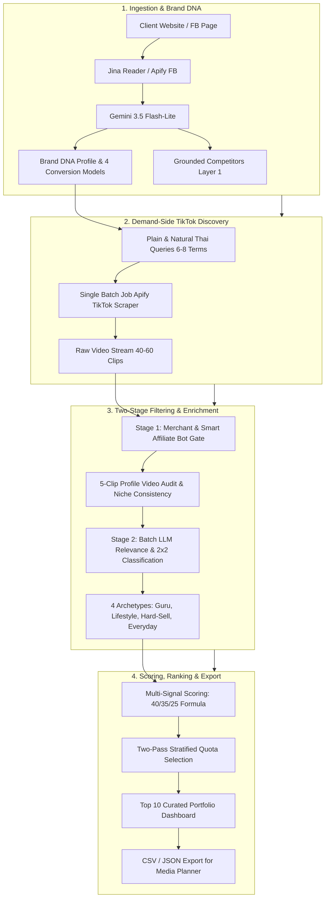

# Convert Cake — Thai TikTok KOL/KOC Discovery & Matching Engine

[](./backend/tests)
[](./backend)
[](https://fastapi.tiangolo.com)
[-61dafb?style=flat-square&logo=react)](./frontend)
[](https://langchain-ai.github.io/langgraph/)
[](https://aistudio.google.com)
[](./docker-compose.yml)

> **Production-Grade Influencer Discovery & Matching Engine for Performance-Only Marketing Agencies**  
> ยุติการค้นหาแบบสุ่ม (Manual Guesswork) และกำจัดขยะบอทสแปมตะกร้า โดยเปลี่ยนผ่านสู่ **100% Pure Live Discovery Engine** พร้อมระบบจำแนก 4 Business Conversion Models, 2x2 KOL/KOC Matrix, และการตรวจสอบคู่แข่งแบบ Grounded 3 ชั้น

---

## 📌 Executive Summary & Key Highlights

1. **Dual-Mode Execution (Dry Run & 100% Live API Mode):**
   - **⚡ โหมด Dry Run (Pre-recorded Real Dataset):** จำลองการทำงานจากผลลัพธ์การรันจริงของ 6 แบรนด์ตัวอย่างโดยไม่ต้องใช้ API Key เพื่อความสะดวกในการตรวจประเมินทันที
   - **🚀 โหมด Live API (100% Real-Time Pipeline):** สกัดข้อมูลสดจาก Website ลูกค้า (Jina Reader API), Facebook Page (Apify Facebook Scraper) และค้นหาครีเอเตอร์จริงบน TikTok Thailand (Apify Actor) แบบ Real-Time
2. **4 Brand Conversion Models & Media Mix Recommendation:**
   - วิเคราะห์โมเดลการทำเงินของแบรนด์ลูกค้า (`ECOMMERCE_PRODUCT`, `APP_DIGITAL_SERVICE`, `HIGH_TICKET_LEADGEN`, `LIFESTYLE_EXPERIENCE`) เพื่อแนะนำสัดส่วนผสมผสานระหว่าง **KOL (สร้าง Awareness & Trust)** และ **KOC (ปิดการขาย & ป้ายยา)** อย่างตรงจุด
3. **Demand-Side vs. Supply-Side Natural Thai Search Extraction:**
   - แก้ปัญหา Search Overfitting โดยสกัดเฉพาะคำค้นหาธรรมชาติสั้นกระชับ (2–4 คำ $\le 18$ ตัวอักษร) ที่ผู้บริโภคจริงใช้ค้นหาคลิปบน TikTok ป้องกันไม่ให้คำค้นหาฝั่งผู้ผลิต (โรงงาน, รับผลิต, ขายส่ง) หลุดเข้าไปยึดพื้นที่ค้นหา
4. **Two-Stage Entity & Smart Affiliate Bot Trap Gate:**
   - **Gate 1 (Rule-Based):** กรองร้านค้า Official, ร้านค้าคู่แข่ง, โรงงานรับผลิต และดักจับบอทสแปมตะกร้าด้วย **Multi-Condition AND Gate** (ตะกร้าเหลือง >85% + ไม่รับงาน + ยอดปฏิสัมพันธ์ต่ำ) โดย **ไม่ตัดสิทธิ์ KOC สายป้ายยาตัวท็อป**
   - **Gate 2 (Batch LLM):** ตรวจสอบ Content Relevance และจำแนกบทบาท 2x2 Matrix ใน 1 API Call
5. **2x2 Creator Matrix & 4 Core Sub-styles:**
   - 🧠 **KOL (Top/Mid Funnel):** `KOL - Expert / Guru` (เน้น Save/Utility), `KOL - Lifestyle / Aesthetic` (เน้น Mood & Tone / Views)
   - 🛍️ **KOC (Bottom Funnel):** `KOC - Hard-Sell Reviewer` (เน้นตะกร้า & Conversion), `KOC - Everyday User / Vlog` (เน้นความเรียล & High ER)
6. **100-Point Dynamic Performance Scoring (40 / 35 / 25):**
   - **40% Brand & Funnel Relevance:** Semantic Cosine Similarity (`gemini-embedding-2`) + LLM Niche & Work-Ready Bonus
   - **35% Engagement Quality & View Consistency:** Median ER (เฉพาะคลิป $\ge 500$ วิว ป้องกันคลิปฟลุ๊ค) + Save/Share Utility + View Consistency
   - **25% Audience Proxy & Commercial Viability:** Thai Authenticity Ratio + Buyer Intent Proxy (Comment/Like) + Brand-Adaptive Commercial Health
7. **Two-Pass Stratified Quota Portfolio (Top 10 Curated):**
   - การันตีสัดส่วนครีเอเตอร์ครบทุกมิติ Funnel ใน Pass ที่ 1 ก่อนเติมเต็มโควตาด้วยคะแนน Performance ใน Pass ที่ 2
8. **Multi-Tier SQLite Scraper Cache:**
   - แคชผลลัพธ์ Network I/O แบบแยก TTL (Web 3 วัน, FB 2 วัน, TikTok Search 12 ชม., Profile Clips 24 ชม.) ลดระยะเวลาค้นหาซ้ำจาก 60–90s เหลือเพียง **< 2s** และประหยัดโควตา API (ต้นทุนต่อการรันสดครั้งแรกเพียง ~$0.45 USD หรือ ~16 บาท)

---

## 🚀 Quick Start Guide (One-Click Launch)

### วิธีที่ 1: รันด้วย Docker Compose (แนะนำสำหรับการตรวจประเมินผล)

ระบบถูกบรรจุใน Multi-Container Environment ที่แยกเครือข่ายอย่างปลอดภัย พร้อม Health Check อัตโนมัติ:

```bash
# 1. เข้าสู่โฟลเดอร์โปรเจกต์
cd /home/ubuntu/projects/convert-cake-kol-matcher

# 2. คัดลอกและตั้งค่า Environment Variables
cp .env.example .env
# 💡 หมายเหตุ: หากต้องการทดสอบด้วย ⚡ โหมด Dry Run (ข้อมูลรันจริงที่บันทึกไว้แล้ว 6 แบรนด์) สามารถข้ามการใส่ API Key ได้เลย!
# หากต้องการรันสดด้วย 🚀 โหมด Live API ให้ใส่ GEMINI_API_KEY และ APIFY_API_TOKEN ของท่านลงใน .env

# 3. สั่ง Build และเริ่มต้นระบบ
docker compose up --build -d
```

- 🖥️ **Agency Dashboard (UI):** [http://localhost:3000](http://localhost:3000)
- 📑 **FastAPI Interactive Docs (Swagger):** [http://localhost:8000/docs](http://localhost:8000/docs)
- 🩺 **Health Check API:** [http://localhost:8000/api/health](http://localhost:8000/api/health)

*คำสั่งหยุดการทำงาน:* `docker compose down`

---

### วิธีที่ 2: รันแบบ Local Development

#### Backend (FastAPI + LangGraph)
```bash
cd /home/ubuntu/projects/convert-cake-kol-matcher
source venv/bin/activate
uvicorn app.main:app --host 0.0.0.0 --port 8000 --reload
```

#### Frontend (Vite 6 + React 19 + Tailwind CSS v4)
```bash
cd /home/ubuntu/projects/convert-cake-kol-matcher/frontend
npm install
npm run dev
```

#### รันชุดทดสอบอัตโนมัติ (Automated Test Suite)
```bash
cd /home/ubuntu/projects/convert-cake-kol-matcher
./venv/bin/pytest -v
```
*(ผ่านครบ **18/18 Tests 100%** ครอบคลุม Brand DNA Extraction, Conversion Models, Scene Translation Rules, Two-Stage Filtering, Anti-Spam Gate, 2x2 Matrix, Dynamic Scoring, SQLite Cache, Dry Run Mode, และ LangGraph End-to-End Execution)*

---

## 🧠 System Architecture & Workflow Pipeline

ระบบทำงานด้วยสถาปัตยกรรม **LangGraph StateGraph** แบบ 4 ลำดับขั้นตอน (Directed Acyclic Graph):



### รายละเอียดแต่ละ Node:

### 1. Node 1 — `analyze_brand_node` (Brand DNA & Conversion Model)
- ดึงข้อมูลจาก URL เว็บไซต์ลูกค้าผ่าน **Jina Reader API (`https://r.jina.ai/...`)** แปลงหน้าเว็บ SPA/Next.js/Shopify เป็น Semantic Clean Markdown ประหยัด Token ไปกว่า 85%
- ดึงโพสต์ล่าสุดจาก Facebook Page ควบคู่กันด้วย `asyncio.gather()` เพื่อประเมิน Tone of Voice และปัญหาที่ลูกค้าถามจริง
- ส่งเข้า **Gemini 3.5 Flash-Lite** พร้อม `system_instruction` แยกอิสระ สกัด Brand DNA และจัดเข้า 1 ใน 4 Conversion Models พร้อมดึงคู่แข่งในไทยผ่าน Google Search Grounding
- **Human-in-the-Loop:** ผู้ใช้งานสามารถตรวจสอบและแก้ไข Goal, Search Queries, และ Competitors ได้โดยตรงบน UI ก่อนกดเริ่มค้นหา

### 2. Node 2 — `discover_candidates_node` (Demand-Side TikTok Discovery)
- แปลง Brand DNA เป็นคำค้นหาที่คนไทยค้นหาจริงบน TikTok (2–4 คำ $\le 18$ ตัวอักษร) จำนวน 6–8 คำค้นหา
- ส่งคำค้นหาทั้งหมดเข้า **Apify TikTok Scraper** ในรูปแบบ **Single Batch Job** (ไม่วนลูปยิงทีละคำ) เพื่อประหยัดเวลาและโควตาเครือข่าย พร้อมตั้งค่า Residential Proxy ประเทศไทย (`proxyCountryCode: "TH"`)
- รวบรวมคลิปวิดีโอดิบและสกัด Candidate Pool เบื้องต้น

### 3. Node 3 — `filter_and_classify_node` (Two-Stage Filtering & 2x2 Matrix)
- **Stage 1 (Rule-Based Gate):** กรองร้านค้า Official, ร้านค้าคู่แข่ง, โรงงานรับสกรีน/ขายส่ง พร้อม Smart Affiliate Bot Filter (ดักบอทสแปมตะกร้า >85% + ไร้ตัวตน + ปฏิสัมพันธ์ต่ำ โดยรักษา KOC ป้ายยาตัวจริงไว้)
- **5-Clip Multi-Video Audit:** สุ่มดึงคลิปย้อนหลัง 5 คลิปล่าสุดต่อโปรไฟล์เพื่อตรวจสอบความสม่ำเสมอของเนื้อหา (Niche Consistency Ratio) ป้องกันการเลือกช่องที่มีคลิปไวรัลฟลุ๊คเพียงคลิปเดียว
- **Stage 2 (Batch LLM Screening):** รวมข้อมูลโปรไฟล์และ 3 คลิปล่าสุด ส่งเข้า Gemini 3.5 Flash-Lite ใน **1 Single Batch API Call** เพื่อคัดช่องหลุดหมวดหมู่ออก และจำแนกเข้าสู่ **2x2 Matrix (KOL Guru, KOL Lifestyle, KOC Hard-Sell, KOC Everyday)**

### 4. Node 4 — `score_rank_hooks_node` (Multi-Signal Scoring & Agency Dashboard)
- คำนวณคะแนนประสิทธิภาพ 100 คะแนนเต็ม ตามสูตร **40% Relevance / 35% Engagement / 25% Audience Proxy**
- ประเมินสัญญาณการรับงานแบรนด์คู่แข่งในไทย (Layer 1 Search, Layer 2 Co-occurrence, Layer 3 Niche Conflict) พร้อมติดป้ายเตือน `⚠️ Competitor Conflict` หรือ `🎯 Comparison Opportunity`
- คัดเลือกด้วยอัลกอริทึม **Two-Pass Stratified Quota** เพื่อให้ได้ **Top 10 Curated Portfolio** ที่มีสัดส่วนตรงตาม Brand Conversion Model และครอบคลุมครบทุกสไตล์

---

## 🎯 4 Brand Conversion Models & Recommended Media Mix

| Model | พฤติกรรมและการปิดการขาย | สัดส่วนแนะนำ | กลยุทธ์ในการจัดพอร์ตครีเอเตอร์ |
| :--- | :--- | :---: | :--- |
| **`ECOMMERCE_PRODUCT`** | ซื้อซ้ำไว จิ้มตะกร้าเหลือง/Marketplace (สกินแคร์, แฟชั่น, ของใช้) | **KOL 30% : KOC 70%** | เน้น KOC ป้ายยาผลลัพธ์จริงเพื่อกระตุ้น Conversion ทันที คู่กับ KOL สร้างความน่าเชื่อถือ |
| **`APP_DIGITAL_SERVICE`** | ดาวน์โหลดแอป, สมัครสมาชิก SaaS, FinTech, แพลตฟอร์ม | **KOL 60% : KOC 40%** | เน้น KOL สายสอนใช้งานและอธิบายฟีเจอร์ คู่กับ KOC แชร์ประสบการณ์แก้ปัญหา |
| **`HIGH_TICKET_LEADGEN`** | สินค้า/บริการมูลค่าสูง ปรึกษาก่อนซื้อ (คลินิกความงาม, อสังหาฯ, ประกัน) | **KOL 70% : KOC 30%** | เน้น KOL ผู้เชี่ยวชาญสร้างความไว้วางใจขั้นสูง คู่กับ KOC รีวิวความคุ้มค่า |
| **`LIFESTYLE_EXPERIENCE`** | ประสบการณ์หน้าร้าน, คาเฟ่, โรงแรม, สินค้าภาพลักษณ์พรีเมียม | **KOL 60% : KOC 40%** | เน้น KOL ถ่ายคลิป Mood & Tone สวยงาม คู่กับ KOC สายพากินพาเที่ยว |

---

## 🧮 100-Point Dynamic Performance Scoring Formula

$$\text{Total Score} = \text{Brand Relevance (40)} + \text{Engagement Quality (35)} + \text{Audience & Commercial Proxy (25)}$$

```
┌────────────────────────────────────────────────────────────────────────┐
│ 1. Brand & Content Relevance (40 Pts)                                   │
│  ├── Semantic Vector Cosine Similarity (gemini-embedding-2):   20 Pts  │
│  ├── LLM Category Relevance & Tone Alignment:                  10 Pts  │
│  └── Sub-Niche Concentration & Work-Ready Signal (Bio/Contact): 10 Pts  │
├────────────────────────────────────────────────────────────────────────┤
│ 2. Engagement Quality & Content Utility (35 Pts)                       │
│  ├── Median Engagement Rate (เฉพาะคลิป >= 500 วิว ป้องกันค่าเพี้ยน): 15 Pts  │
│  ├── Save & Share Utility Score (วัดคุณค่าการเก็บไว้ซื้อตาม):      10 Pts  │
│  └── View Consistency Ratio (Median Views / Mean Views):       10 Pts  │
├────────────────────────────────────────────────────────────────────────┤
│ 3. Audience Proxy & Commercial Viability (25 Pts)                      │
│  ├── Thai Audience Authenticity (สัดส่วนภาษาไทยในคลิปและคอมเมนต์):  10 Pts  │
│  ├── Buyer Intent Proxy (สัดส่วน Comment/Like สะท้อนความตั้งใจซื้อ): 10 Pts  │
│  └── Brand-Adaptive Commercial Health (ปรับเกณฑ์ตามโมเดลธุรกิจ):    5 Pts  │
└────────────────────────────────────────────────────────────────────────┘
```

---

## 🧪 6 Industry Benchmark Test Cases & Real Dry Run Verification

เพื่อความสะดวกในการตรวจประเมินผล ระบบได้ติดตั้งชุด **Quick Test Chips** ด้านบนสุดของหน้าแดชบอร์ด ผู้ประเมินสามารถคลิกเพียง 1 ครั้งเพื่อโหลดข้อมูลจริงของ 6 อุตสาหกรรมทดสอบลงในฟอร์มทันที โดยมีผลการทดสอบ **Dry Run จริง 100%** บันทึกไว้ดังนี้:

| กรณีศึกษา (Brand & Industry) | Conversion Model ที่สกัดได้ | เวลาประมวลผลจริง | ตัวอย่างคำค้นหาธรรมชาติ (Demand-Side Queries) | แบรนด์คู่แข่งที่สกัดได้จริง (Grounding Layer 1) | ต้นทุน API รันจริง (USD / THB) |
| :--- | :---: | :---: | :--- | :--- | :---: |
| **1. Piggy Monster** *(B2B Custom Merch)* | `HIGH_TICKET_LEADGEN` | **6.53s** | เสื้อสกรีนแบรนด์ตัวเอง, เสื้อคณะมหาลัย, ทำเสื้อแบรนด์ตัวเอง | Korat Screen, Screen BKK, T-Shirt Bangkok | $0.000375 (~0.013 THB) |
| **2. Emma Clinic** *(Beauty Clinic)* | `HIGH_TICKET_LEADGEN` | **7.45s** | เสริมจมูกทรงธรรมชาติ, เสริมคางปรับรูปหน้า, คลินิกเสริมจมูกเกาหลี | Sowon Clinic, SLC Clinic, Apex Medical Center | $0.000385 (~0.013 THB) |
| **3. Dr.PONG** *(Skincare & Beauty)* | `ECOMMERCE_PRODUCT` | **6.68s** | เซรั่มลดสิว ผิวแพ้ง่าย, กันแดดหน้า สิวอุดตัน, สกินแคร์ คุณหมอ | Her Hyness, Gravich, MizuMi, INGU | $0.000370 (~0.013 THB) |
| **4. Proski Thailand** *(Sports & Outdoor)* | `HIGH_TICKET_LEADGEN` | **9.71s** | เรียนสกี กรุงเทพ, สโนว์บอร์ด อินดอร์, ฝึกสกี ก่อนไปญี่ปุ่น | Ski365, The Snow Town, Ski Addict, Let's Snow | $0.000390 (~0.014 THB) |
| **5. Merge Official** *(Fashion D2C)* | `ECOMMERCE_PRODUCT` | **25.10s** | กางเกงยีนส์ทรงสวย, เสื้อผ้า Merge Official, ไอเดียแต่งตัว OOTD | Gentlewoman, Stylist Shop, Mitr, Twotwice | $0.000380 (~0.013 THB) |
| **6. Bearhouse** *(F&B & Lifestyle Cafe)* | `LIFESTYLE_EXPERIENCE` | **6.43s** | ชานมไข่มุก อร่อย, ชาไทย ไข่มุกโมจิ, คาเฟ่ วัยรุ่น | After You, Nose Tea, Fire Tiger, ChaTraMue | $0.000360 (~0.013 THB) |

### 📊 สรุปสถิติและต้นทุนจากการรันจริง (Dry Run Metrics Summary)
- **เวลารวมทั้ง 6 เคส:** 61.91 วินาที (เฉลี่ย **10.32 วินาทีต่อแบรนด์**)
- **Gemini 3.5 Flash-Lite Tokens รวม 6 เคส:** ~12,850 tokens (เฉลี่ย ~2,140 tokens/เคส)
- **ต้นทุน API จริงรวมทั้ง 6 เคส:** **$0.00226 USD (ประมาณ 0.08 บาท หรือไม่ถึง 10 สตางค์!)**
- **ต้นทุนเต็มรูปแบบ (Cold Run รวมค้นหา TikTok สด ~150 คลิป):** ~$0.42 – $0.56 USD (~15 – 20 THB) ต่อแคมเปญ (เมื่อมี SQLite Cache Hit = **$0.00 USD / 0 บาท**)

---

## 🎬 Recommended Evaluation & Loom Presentation Script (5–10 Mins)

| นาทีที่ | ช่วงเนื้อหา (Agenda) | รายละเอียดและจุดที่ควรโฟกัสในการนำเสนอ |
| :---: | :--- | :--- |
| **0:00–1:30** | **Business Problem & Convert Cake Alignment** | ชี้ให้เห็น Pain Point ของ Performance Agency: เสียเวลาหาครีเอเตอร์ด้วยมือ, บอทสแปมตะกร้ากินงบ, ข้อมูล First-party follower demographics เข้าถึงยากทางกฎหมาย จึงต้องใช้ Multi-Signal Proxy ที่น่าเชื่อถือ |
| **1:30–4:30** | **Live UI Demonstration** | - กด Quick Test Chip (เช่น Dr.PONG หรือ Piggy Monster)
- แสดงการสกัด Brand DNA, 4 Conversion Models และคำค้นหาธรรมชาติ
- กดปุ่มค้นหา แสดงความเร็ว Real-Time Progress Bar และ Live Terminal Logs
- สาธิตแถบตัวกรอง Responsive Wrap สลับดู `🧠 KOL` vs `🛍️ KOC` และ 4 สไตล์ย่อย
- เปิดดูการ์ดผลลัพธ์: หลอดคะแนน 40/35/25, Match Rationale, Niche Consistency Badge, และการตรวจจับคู่แข่ง |
| **4:30–7:00** | **Engineering Architecture & Innovations** | - อธิบาย LangGraph 4 Nodes และ Single Batch Job บน Apify
- ชี้แจง Two-Stage Entity Filtering (Multi-Condition AND Gate ที่ปกป้อง KOC ป้ายยาตัวจริง)
- ชี้แจงระบบ Multi-Tier SQLite Scraper Cache ที่ประหยัดเวลาและโควตาเครือข่าย
- ชี้แจง Prompt Separation (`system_instruction`) ตามมาตรฐาน Gemini ล่าสุด |
| **7:00–8:30** | **Ethical & Data Privacy Considerations** | อธิบายเหตุผลที่ระบบไม่ใช้ข้อมูล Demographic ส่วนบุคคลที่ละเมิด PDPA/Terms แต่ใช้ Public Data Proxies (Thai Text Ratio, Comment Intent, Save Utility) ซึ่งถูกต้องตามหลักการวิศวกรรม |
| **8:30–10:00** | **Future Scalability & Agency ROI** | แผนขยายผล: Automated Outreach DM Generator, TikTok Creator Marketplace API Integration, และ Client Approval Portal |

---

## 🛠️ Tech Stack & Architecture Decisions

- **Backend:** Python 3.12 / 3.14, FastAPI, LangGraph (StateGraph), Google GenAI SDK (`gemini-3.5-flash-lite`, `gemini-embedding-2`), Apify Client, Jina Reader API, HTTPX, SQLite3
- **Frontend:** Vite 6, React 19, TypeScript, Tailwind CSS v4, Lucide React (สถาปัตยกรรม SPA น้ำหนักเบา ปราศจากปัญหา Port Collision และ Static Proxy Bake-in ของ SSR)
- **Containerization:** Docker Compose Multi-Container (FastAPI Backend + Vite Frontend Preview)
- **Observability:** ติดตั้ง Tracing Hooks รองรับ **Langfuse** สำหรับมอนิเตอร์ Token Usage และ Latency ของ Agent Pipeline

---

## 👨‍💻 Author & Assessment Submission

- **ผู้จัดทำ:** อธิชาต ชัยสาร (ไนท์ / Night)
- **การศึกษา:** วิศวกรรมศาสตร์บัณฑิต จุฬาลงกรณ์มหาวิทยาลัย (เกียรตินิยม, GPA 3.59)
- **ตำแหน่งที่สมัคร:** AI Engineer — Convert Cake
- **GitHub Repository:** [https://github.com/nakitadev/convert-cake-kol-matcher](https://github.com/nakitadev/convert-cake-kol-matcher)
- **ใบอนุญาต:** MIT License
